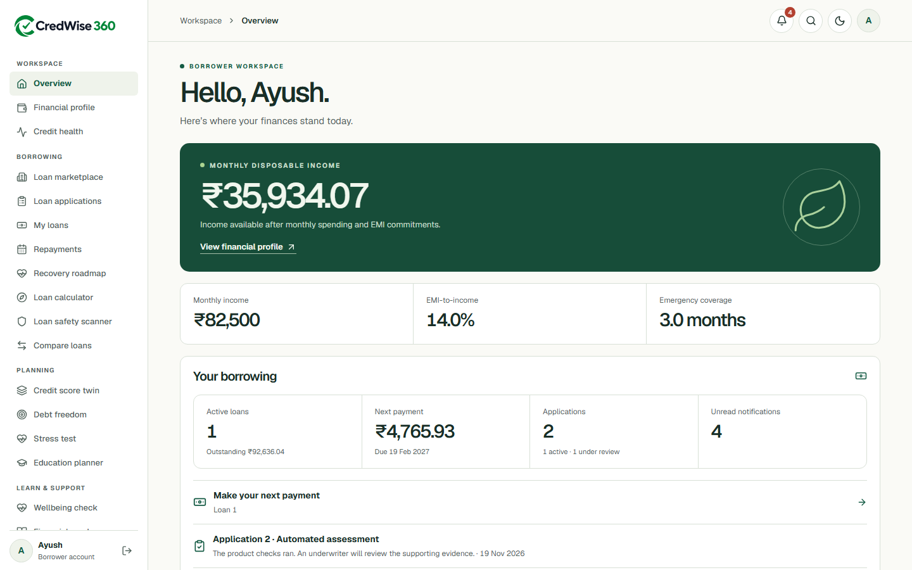
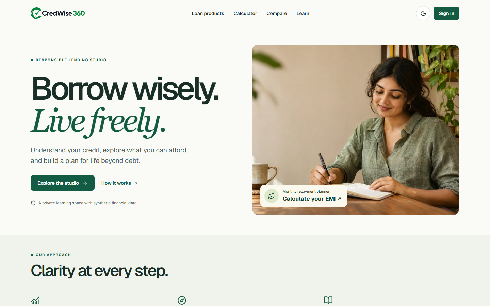
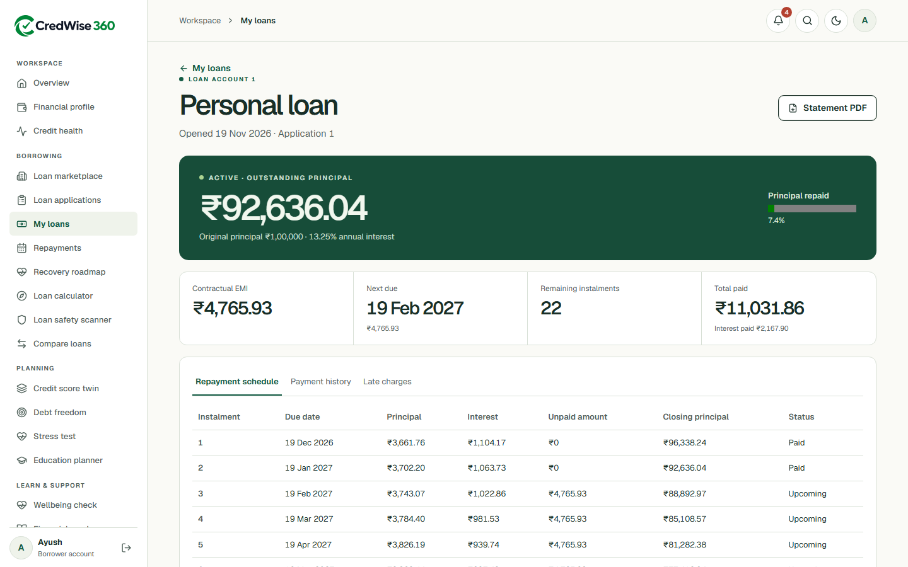
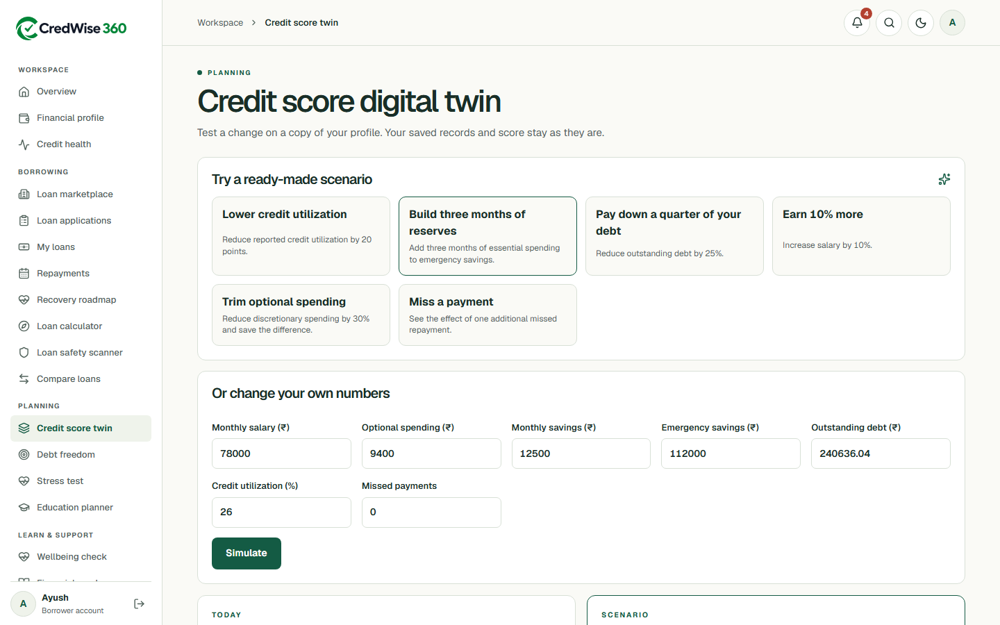
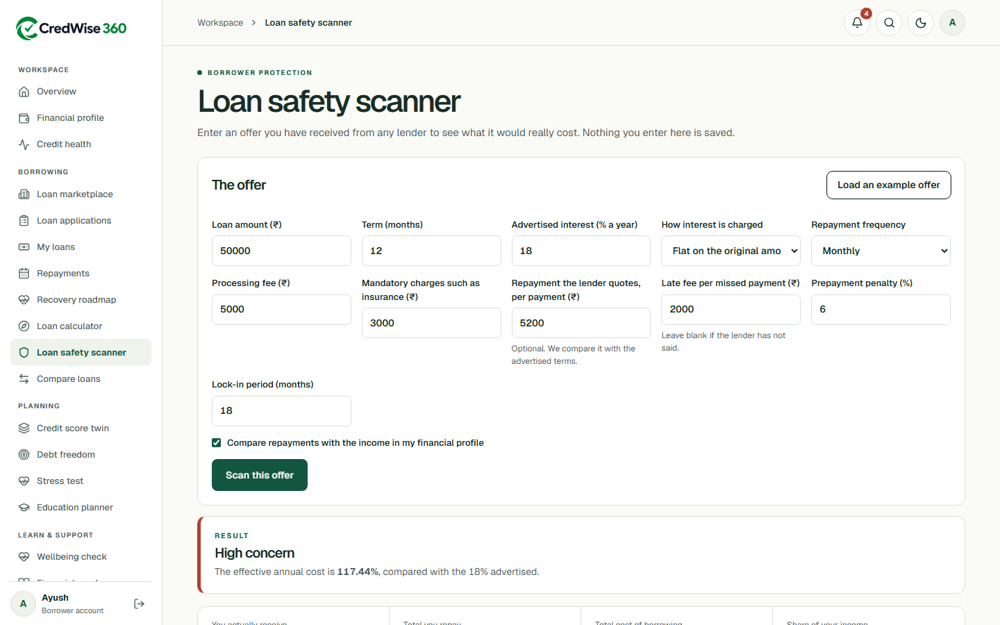
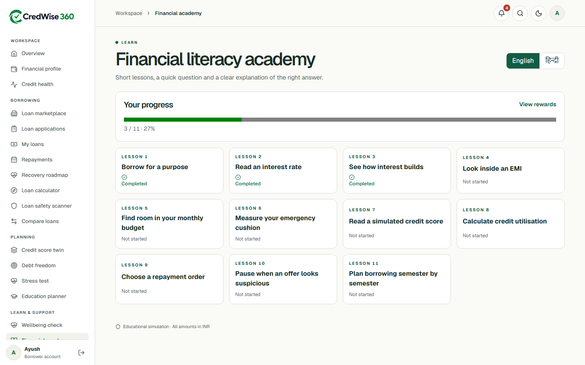
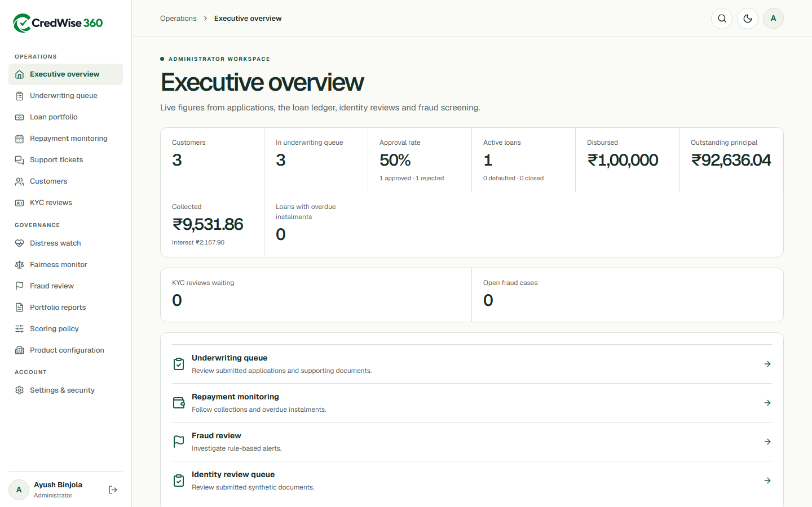
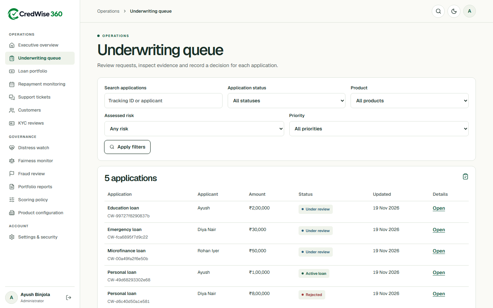
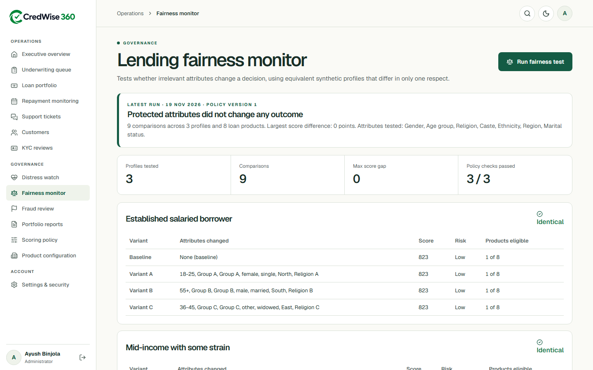
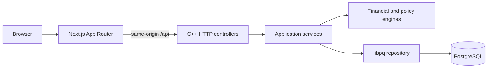

<p align="center">
  <picture>
    <source media="(prefers-color-scheme: dark)" srcset="apps/web/public/brand/logo-dark.svg">
    <source media="(prefers-color-scheme: light)" srcset="apps/web/public/brand/logo-light.svg">
    
  </picture>
</p>

# CredWise 360

**A responsible-lending studio built on a native C++20 API and PostgreSQL.**

CredWise 360 simulates the full borrowing journey: understanding credit, choosing a loan, applying, being underwritten, repaying, and recovering if things go wrong. Every calculation, state transition and rule runs in an object-oriented C++ service. The Next.js web app presents the results. All identities, documents and money are synthetic, and the project is an educational simulation, not a financial product.

**Live demo: [credwise360.onrender.com](https://credwise360.onrender.com/)**. Sign in with the [demo accounts](#demo-accounts) below. The free hosting plan sleeps when idle, so the first load can take a minute.



## Screenshots

| | |
| --- | --- |
|  **Public landing page** |  **Loan servicing and repayment schedule** |
|  **Credit score digital twin** |  **Loan safety scanner** |
|  **Bilingual financial academy** |  **Administrator overview** |
|  **Underwriting queue** |  **Lending fairness monitor** |

The interface is responsive, with light and dark themes. A phone-width view is in [docs/screenshots/10-mobile-dashboard.png](docs/screenshots/10-mobile-dashboard.png).

## Features

**Lending lifecycle**
- Eight loan products with configurable pricing, eligibility, fees and prepayment rules.
- Quotes, side-by-side comparison and ranked recommendations that never raise the amount requested.
- Applications with synthetic document evidence, underwriting decisions, frozen offers and simulated disbursement.
- EMI, partial, advance, prepayment and full-settlement payments, with late charges, default documentation and closure certificates. Payments are idempotent and concurrency-safe.

**Credit and planning**
- Explainable credit scoring with conventional and alternative (rent, utilities, cash flow) evidence, versioned policy and score history.
- Credit score digital twin, debt freedom navigator (avalanche and snowball), financial stress test and education loan planner, with saved scenarios.

**Protection and care**
- Loan safety scanner that reconstructs the true cost of an outside offer and explains each warning.
- Financial wellbeing check with supportive outreach, and support tickets with evidence, resolution history and reconsideration of rejected applications.

**Learning and recognition**
- Financial literacy academy in English and Hindi with quizzes and explanations.
- Points and badges for learning and responsible repayment. No rule rewards taking or increasing a loan.

**Oversight and reporting**
- Fairness monitor using counterfactual tests on equivalent synthetic profiles.
- Rule-based fraud review, notifications with due-date reminders, dashboards and portfolio reports.
- PDF documents rendered by the C++ service (financial health, credit assessment, loan statement, closure certificate, planning scenarios, portfolio) and CSV export.

The [feature ledger](FEATURE_STATUS.md) records what was verified, how, and what is not implemented.

## Architecture



- **Web (`apps/web`)** renders pages and forwards same-origin API requests. It holds no business rules.
- **API (`services/core`)** is organised as controllers, services, domain objects, engines, security and repositories. Notable designs include a state machine for applications and support tickets, strategy classes for scoring, safety, distress and reward rules, a factory for loan products, RAII transactions, and a small PDF writer.
- **Database (`database/migrations`)** owns persistence, constraints and transactions. Money is stored and transmitted as integer paise.

More detail: [architecture](docs/architecture.md), [data model](docs/data-model.md), [financial model](docs/financial-model.md), [credit policy](docs/credit-policy.md) and the [OpenAPI contract](docs/openapi.json).

## Technology

| Layer | Technology |
| --- | --- |
| API | C++20, CMake and Ninja, libpq, OpenSSL, [cpp-httplib](https://github.com/yhirose/cpp-httplib), [nlohmann/json](https://github.com/nlohmann/json) |
| Database | PostgreSQL with SQL migrations |
| Web | Next.js (App Router), React, TypeScript, Tailwind CSS, TanStack Query, React Hook Form, Zod, Recharts, Lucide icons |
| Testing | CTest (native), Node test runner (API), Playwright (browser) |
| Delivery | Docker Compose and GitHub Actions configuration |

## Getting started on Windows

Requirements: Windows 10 or 11 with PowerShell, Node.js 24, npm and Git. The bootstrap script fetches a local C++ toolchain and PostgreSQL into the repository's `.local` folder and keeps database credentials outside the checkout.

```powershell
.\scripts\bootstrap-windows.ps1     # one time
.\scripts\start-demo.ps1            # builds if needed, starts everything, seeds demo data
```

Open http://127.0.0.1:3000. Stop with `.\scripts\stop-demo.ps1`. The first run compiles the C++ service and builds the web app, which takes a few minutes. Logs are in `.local\logs`.

To build and run the pieces yourself:

```powershell
. .\scripts\env.ps1
cmake -S . -B build -G Ninja
cmake --build build --parallel 2
ctest --test-dir build --output-on-failure
npm.cmd ci
npm.cmd run build
.\build\services\core\credwise.exe     # API on 127.0.0.1:8787
npm.cmd start                          # in a second terminal, web on 127.0.0.1:3000
```

### Docker Compose

Copy `.env.example` to `.env`, set a local PostgreSQL password, then run `docker compose up --build` and open http://localhost:3000. Seed the demo accounts once the stack is healthy with `WEB_URL=http://localhost:3000 npm run seed:demo`. The Compose and Dockerfile configuration was written alongside the Windows setup but has not been executed in the author's environment.

### Hosted deployment (Render and Neon)

The repository includes a [Render blueprint](render.yaml) and a single-container image ([deploy/render/Dockerfile](deploy/render/Dockerfile)) that serves the web app on Render's `PORT` and connects to an external Neon PostgreSQL database over SSL. Migrations and demo initialization run automatically at startup. See [docs/deployment.md](docs/deployment.md) for the exact settings and environment variables.

## Demo accounts

All accounts use the password `CredWiseDemo!360`. They exist only in demo mode (`DEMO_MODE=1`) and hold synthetic data.

| Role | Email | What it shows |
| --- | --- | --- |
| Borrower | `borrower@credwise.test` | Ayush: verified KYC, a funded ₹1,00,000 personal loan with two EMIs repaid, an education loan application under review, and completed academy lessons |
| Administrator | `admin@credwise.test` | Ayush Binjola: underwriting queue, loan portfolio, fraud review, support tickets, fairness monitor, reports, scoring policy and product configuration |
| Borrower | `diya.nair@credwise.test` | A rejected application with a recovery roadmap and a reconsideration ticket awaiting her reply |
| Borrower | `rohan.iyer@credwise.test` | A thin credit file assessed from consented alternative evidence, with a microfinance application pending |

`npm run seed:demo` creates this data through the real REST workflows, so every record is a genuine ledger entry. It is safe to run repeatedly. A guided tour is in [docs/demo-walkthrough.md](docs/demo-walkthrough.md).

## Testing

`node scripts/check-phase.mjs` (after loading `scripts/env.ps1`) is the full regression gate. It builds the C++ and web applications, runs the native suites, applies migrations twice, starts both services on dedicated ports against a separate PostgreSQL schema, then runs the API and browser tests. The latest run passed 6 native suites, 27 API tests and 20 browser tests.

With both services running you can also use `npm run test:api` and `npm run test:browser` (install the browser once with `npx playwright install chromium`). Coverage includes loan arithmetic reconciled to the paisa, state machines, late penalties, default documentation, concurrent and idempotent payments, authorization between roles, fairness invariants, PDF structure, and a route-by-route accessibility and overflow inventory at three widths.

## Repository layout

| Path | Contents |
| --- | --- |
| `apps/web` | Next.js application |
| `services/core` | C++ API: `controllers`, `services`, `domain`, `engines`, `security`, `repositories`, `tests` |
| `database` | SQL migrations and the academy lessons |
| `docs` | Architecture, data model, API contract, academic guide, screenshots |
| `scripts` | Windows bootstrap, demo launcher, seed scripts, regression gate |
| `tests` | API and browser tests |

## Documentation

[Academic guide and viva notes](docs/academic-guide.md) · [Acceptance matrix](docs/acceptance-matrix.md) · [Feature ledger](FEATURE_STATUS.md) · [Implementation roadmap](IMPLEMENTATION_PLAN.md) · [Development brief](docs/DEVELOPMENT_BRIEF.md) · [Visual asset notes](docs/visual-assets.md) · [Brand guide](docs/brand.md)

## Limitations

This is an educational simulation. Scores are simulated and independent of any credit bureau. Disbursements, payments and identity checks are synthetic. Known gaps (no screen-reader testing, no email or SMS delivery, container configuration not executed, and others) are listed in the [feature ledger](FEATURE_STATUS.md).

## Acknowledgements

- The two editorial photographs on the public pages are AI-generated images of fictional people. See [docs/visual-assets.md](docs/visual-assets.md).
- Third-party software keeps its own licences. `cpp-httplib` and `nlohmann/json` are vendored unmodified with their MIT notices ([services/core/vendor/README.md](services/core/vendor/README.md)). Web dependencies are listed in `package-lock.json`. The interface uses the Geist typeface (SIL Open Font License) and Lucide icons.

## Author

Created by **Ayush Binjola** ([@AyushBinjola1](https://github.com/AyushBinjola1)).
