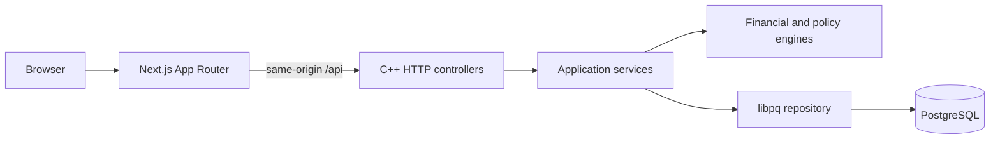

# System architecture

Each API operation opens a connection through a repository adapter. An RAII transaction commits the ledger, account activity and related events together. PostgreSQL locks serialize conflicting financial writes. Read models and exports select from the same durable rows as the customer and operations workspaces.

The HTTP layer owns sessions, request parsing, response envelopes and security headers. The frontend owns display units, accessible control state, and navigation. Monetary values at the API boundary are integer paise.
