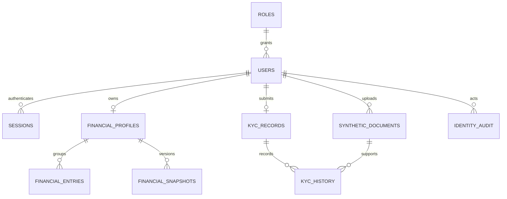

# Relational data model

All timestamps use PostgreSQL `timestamptz`. Money travels and persists as integer paise. Identifiers are database-assigned integers, and records with an owner are selected with that owner or through an authorized administrator route.

| Relation | Responsibility |
| --- | --- |
| schema_migrations, system_events | Record committed schema versions and system initialization. A transaction-scoped advisory lock serializes migrations. |
| users, roles, sessions | Store account state, password and recovery hashes, opaque session hashes and expiry. |
| auth_attempts | Index login, recovery and registration events by pseudonymous account/network keys and time. |
| financial_profiles, financial_entries | Store profile context and one amount per user and financial category. Checks bound durations and monetary values. |
| financial_snapshots | Preserve the profile and its calculated metrics at the time of a profile change. |
| synthetic_documents, kyc_records, kyc_history | Keep bounded synthetic document bytes, review status, rejection reasons and review history. A composite foreign key associates the file with its submitting account. |
| identity_audit | Record account, profile and verification actions for later investigation. |

The SQL files in [database/migrations](../database/migrations) define exact constraints and indexes. A successful migration inserts its filename and deployment time in the same transaction.
