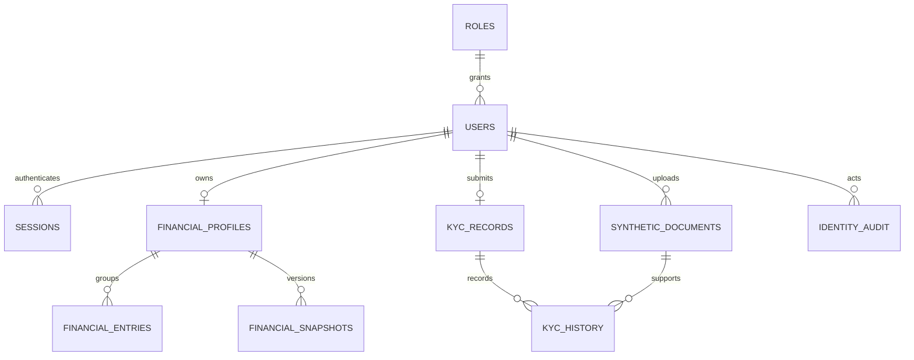

# Relational data model

All timestamps use PostgreSQL `timestamptz`. Money travels and persists as integer paise. Identifiers are database-assigned integers, and records with an owner are selected with that owner or through an authorized administrator route.

| Relation | Responsibility |
| --- | --- |
| schema_migrations, system_events | Record committed schema versions and system initialization. A transaction-scoped advisory lock serializes migrations. |
| users, roles, sessions | Store account state, password and recovery hashes, opaque session hashes and expiry. |
| auth_attempts | Index login, recovery and registration events by pseudonymous account/network keys and time. |
| financial_profiles, financial_entries | Store profile context and one amount per user and financial category. Checks bound durations and monetary values. |
| financial_snapshots | Preserve the profile and its calculated metrics at the time of a profile change. |
| synthetic_documents, kyc_records, kyc_history | Keep bounded synthetic document bytes, review status, rejection reasons and review history. A composite foreign key associates the file with its submitting account. |
| identity_audit | Record account, profile and verification actions for later investigation. |
| scoring_policies | Keep immutable versions of conventional and alternative weights, thresholds and the administrator’s change note. |
| credit_assessments, credit_score_history, credit_inquiries | Associate the current assessment with its policy, retain score changes, and count distinct inquiries within the policy window. |
| loan_products, product_policy_changes | Keep eight independent product policies and preserve the previous and new terms when an administrator changes pricing or eligibility. |
| loan_applications, application_documents, application_events, application_decisions | Hold each application with its frozen offer, evidence, timeline and underwriting decisions. A check constraint limits the status set and composite keys tie documents to the owner. |
| loans, repayment_schedules, repayment_transactions, loan_penalties, closure_certificates | The servicing ledger. A unique idempotency key per user, a check that every payment splits exactly into principal, interest, fee and penalty, and one disbursement per loan keep the books reconciled. |
| planning_scenarios | Saved digital twin, stress, debt and education plans with their inputs and the recomputed result. |
| notifications | In-app messages with a unique `(user_id, dedupe_key)` so repeated events never duplicate. |
| fraud_cases | Rule-based alerts, unique per user, rule and subject so a rescan keeps the investigator’s decision. |
| disputes, dispute_messages | Support tickets and their append-only history, including optional synthetic evidence and the final resolution. |
| quiz_attempts, reward_events, reward_badges | Academy answers (the answer key stays on the server), the points ledger with a unique reference per award, and earned badges. |
| distress_cases | Latest wellbeing indicators and any supportive outreach recorded by an administrator. It is never an input to scoring. |
| fairness_runs | Each counterfactual test run, with the policy version it tested. |

The SQL files in [database/migrations](../database/migrations) define exact constraints and indexes. A successful migration inserts its filename and deployment time in the same transaction.
